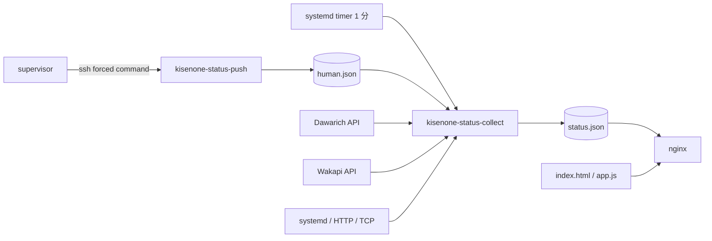

# status.kisen.one

kisenone が今何をしているか、どこの都道府県にいるか、今日どれだけコードを書いたか、動かしているサービスが生きているかを出すページ。

> [!NOTE]
> 自分 (kisenone) のサーバーで動かすためだけに作ったもので、ほかの人が使うことは想定していない。名前や表示に kisenone が入っていて、取得元 (Dawarich、Wakapi、状態を送る手元のツール) も決め打ちにしている。issue や PR への対応、互換性の維持もしない。コードは読み物として公開している。
>
> This is a personal project built only for my own server. It is not intended for reuse: names and labels are hard-coded, and the data sources are fixed. Issues, pull requests, and compatibility are not maintained.

- 今の状態: 手元の作業の補助ツールが `computering` / `delegating` / `reading` / `sleeping` などのカテゴリ、状態になった時刻、動かしているエージェントの数 (省略可) を ssh で送ってくる。`ai_ratio_today` は、当日の `computering` / `delegating` の時間のうち AI が並走していた割合
- 位置: [Dawarich](https://dawarich.app) の最新の点から、国と都道府県を手元で判定する。座標は外に出さない。`utc_offset_minutes` は時間帯の多角形から出した UTC からの差で、夏時間は見ない
- コーディング: [Wakapi](https://wakapi.dev) の今日の合計、上位 3 言語、OS (`oses`) の割合。project 名は出さない
- サービス: systemd / HTTP / TCP で死活を確かめる。個人用のものは名前と状態だけ

データは [`/status.json`](https://status.kisen.one/status.json) にあり、CORS を開けているので他のページからも読める。

## 構成



- collector は Python の標準ライブラリだけで書いた oneshot。取得元の 1 つが失敗しても、そのセクションだけ前回の値を残す
- frontend はビルドなしの HTML / CSS / JS。`status.json` を 60 秒ごとに取り直し、相対時刻と古さの判定はブラウザで行う
- 詳しくは [docs/design.md](docs/design.md)

## 動かし方 (自分用のメモ)

自分の NixOS の構成からは、次のように読み込んでいる。

```nix
{
  inputs.kisenone-status.url = "github:kisepichu/status.kisen.one";

  outputs = { nixpkgs, kisenone-status, ... }: {
    nixosConfigurations.host = nixpkgs.lib.nixosSystem {
      system = "x86_64-linux";
      modules = [
        kisenone-status.nixosModules.default
        {
          services.kisenone-status = {
            enable = true;
            environmentFile = "/run/secrets/kisenone-status.env"; # DAWARICH_API_KEY=… / WAKAPI_API_KEY=…
            dawarich.url = "http://127.0.0.1:3001";
            wakapi.url = "http://127.0.0.1:3000";
            pushKeys = [ "ssh-ed25519 AAAA… presence" ];
            services = [
              { name = "blog"; url = "https://example.com/"; check = { type = "http"; target = "https://example.com/"; }; }
              { name = "db"; private = true; check = { type = "systemd"; target = "postgresql.service"; }; }
            ];
          };
        }
      ];
    };
  };
}
```

nginx が `127.0.0.1:8087` で listen する。外への公開は reverse proxy や tunnel で行う。

状態の push:

```sh
ssh -i ~/.ssh/presence kisenone-status@host computering "$(date +%s)"
```

受け付けるのは `computering` `delegating` `reading` `chore` `eating` `sleeping` `working` `away` と、7 日以内の epoch 秒、省略可の agents (0〜99) だけ。10 分届かなければページは `offline` と出す。

## 開発

```sh
python3 -m unittest discover -s tests -t . -v   # 実データの境界テストは skip される
nix flake check -L                               # 実データの境界テストと NixOS VM test (KVM が要る)
git config core.hooksPath githooks               # ~/.config/kisenone-status/denylist の語を commit に入れない
```

## 出典

- 都道府県の境界: 国土数値情報 (行政区域データ) (国土交通省) を加工して作成 ([smartnews-smri/japan-topography](https://github.com/smartnews-smri/japan-topography) の簡略化版を使用)
- 国境: [Natural Earth](https://www.naturalearthdata.com/) (public domain)
- 時間帯: [Natural Earth](https://www.naturalearthdata.com/) の time zones (public domain)
